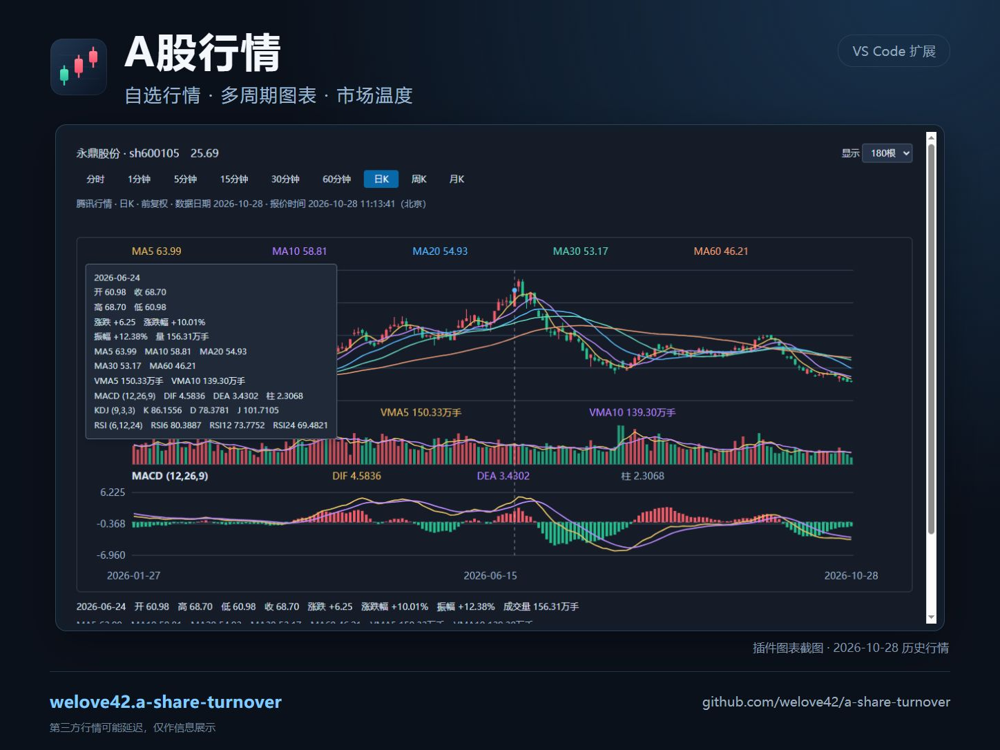
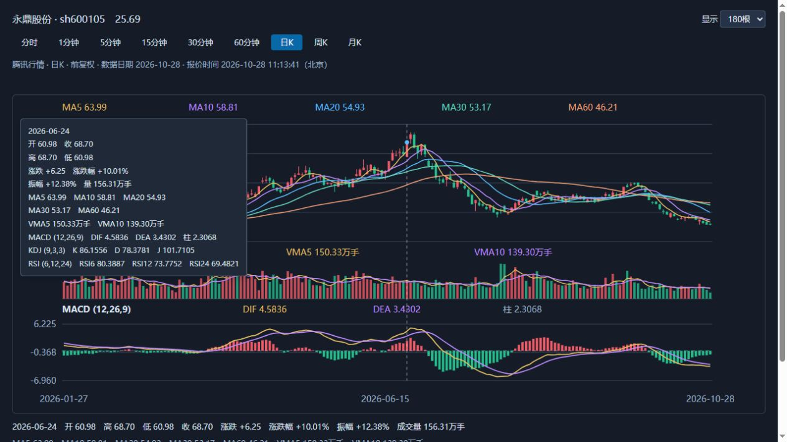
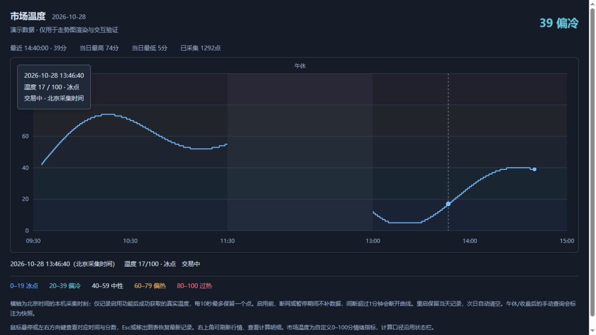

# A股行情 · 把行情，放进 VS Code

**在熟悉的编辑器里，查看自选行情、市场温度、财经快讯和重要事件。**

A股行情为 VS Code 提供紧凑的状态栏、可折叠的行情列表和独立图表页：盘中看成交额是否放大，点开自选查看多周期走势，也能关注港美股、基金、全球指数、商品和财经大事。

[安装扩展](https://marketplace.visualstudio.com/items?itemName=welove42.a-share-turnover) · [GitHub 源码](https://github.com/welove42/a-share-turnover) · [使用手册](docs/USER_GUIDE.zh-CN.md) · [反馈问题](https://github.com/welove42/a-share-turnover/issues)



*海报使用插件真实图表截图；截图中的行情为2026年10月28日的历史数据。*

## 一眼看盘，按需展开

首次安装默认显示行情。临时不想显示行情时，按 **Ctrl+Shift+;** 隐藏行情，侧栏改为运行和调试页面（按钮仅作展示），再按一次恢复。重启 VS Code 后仍保持隐藏；自选和原来的暂停设置都会保留。

| 功能 | 你可以做什么 |
| --- | --- |
| 老板键 | 一键隐藏状态栏、行情列表和插件图表，同时暂停行情刷新和提醒；再次按键恢复。 |
| 成交额同刻对比 | 交易期间每10秒更新沪深A股累计成交额，对比上一交易日同一时刻的放量或缩量，显示比例和差额。 |
| 领涨板块 | 状态栏显示涨幅最高的行业板块，悬停查看前十；可在设置中切换为概念板块。 |
| 中文搜索自选 | 按中文名、拼音或代码添加股票和ETF，支持批量代码输入；列表显示现价与涨跌幅，支持拖拽调整自选顺序。 |
| 港股、美股自选 | 在对应折叠分组旁点击＋，按名称或代码添加；按本地常规交易时段刷新，行情可能延迟，点击可在浏览器查看详情。 |
| 5日分时 | 个股详情中查看最近最多5个交易日的逐分钟走势、成交量、每日均价和技术指标；悬停查看日期与数值。 |
| 多周期技术图表 | 分时、日K、周K、月K及1/5/15/30/60分钟K线；支持均线、成交量、MACD、KDJ、RSI。 |
| 市场温度走势 | 查看0–100分自定义市场情绪指标，从冰点到过热；当天曲线支持悬停查看时间与分数。 |
| 基金与持仓收益 | 关注已公布净值涨跌；填写份额和剩余持仓总成本后，计算当前持仓市值、收益和收益率。 |
| 全球指数与商品 | 默认关注纳指综合、日经225、韩国KOSPI，以及伦敦金、布油、伦敦铜和伦敦银；其他品种自行添加。 |
| 财经快讯 | 在底部输出面板阅读7×24快讯，支持未读计数、来源切换和独立暂停。 |
| 财经大事提醒 | 状态栏显示最近事件及倒计时，点击查看美联储议息、股指交割、A股/港股/美股休市、美国非农与 CPI 日历。 |

### 财经大事日历

事件在 VS Code 运行期间默认于开始前 24 小时及 30 分钟内各提醒一次；启动较晚时只提醒当前最临近的阶段，同一事件不会因重启重复提醒。设置中可关闭提醒、关闭整个栏目，或按类型选择关注的事件。日历显示北京时间，点击事件可打开官方来源。

插件每天自动从 [Finance Calendar](https://www.financecalendar.com/) 获取美联储议息、非农、CPI 和美股提前收盘，从 [Markets Open](https://marketsopen.today/) 获取 A 股、港股和美股休市及港股半日市；同时尝试美联储和美国劳工统计局官方日历。Markets Open 数据采用 [CC BY 4.0](https://creativecommons.org/licenses/by/4.0/)，界面保留来源、数据版本和获取时间。免费接口可能限流或变更，并不保证持续可用。

每项数据按年份或时间窗口独立回退：接口未覆盖、网络出错或数据校验失败时，保留上次成功的缓存或使用内置官方公告快照，并标明来源与时间。A 股、港股内置快照覆盖 2026 年，美股覆盖 2026–2028 年；在线源尚未收录的未来年份不会凭空生成。股指交割按中金所规则及已验证的 A 股交易日历推算，临时调整以交易所公告为准。扩展不能在 VS Code 未运行时推送通知，美国事件根据美东夏令时自动转换北京时间。

## 状态栏：把市场变化收进一行

```text
成交量 8650.36亿 | 放量 12.35% (+950.73亿)   [上证指数] 3250.60 ▲ (+0.86%)   温度 65 偏热
领涨板块 示例板块 +2.35%   美国非农 3天   新闻
```

*以上数字为虚构示例。底部“成交量”采用累计成交额口径，单位为亿元。*

- 默认比较上一交易日同一时刻，也可切换为上一交易日全天；悬停查看比较日期与数据时间。
- 底部指数默认显示上证指数，点击可选择自选个股。
- 领涨板块悬停显示前十；点击财经大事打开事件日历，查看来源及北京时间。
- 达到设定阈值时，结合成交额变化与上证跌幅提示“放量下跌”或“缩量下跌”。
- 自选行情在交易日09:15起自动刷新，覆盖盘前集合竞价；各模块支持按需暂停。

## 点开个股，直接查看图表

同一详情标签可反复切换股票；周期在顶部切换，MACD、KDJ、RSI按钮紧贴技术指标副图上方，读图说明位于副图下方；右上角保留来源、刷新和浏览器打开。



*图表界面截图；历史数据仅用于展示交互，不代表实时行情。*

- **分时与均价**：股票和ETF支持按累计成交额、成交量计算的成交均价线。
- **常用指标**：MA5/10/20/30/60、VMA5/10，以及MACD、KDJ、RSI副图。
- **历史细节**：鼠标悬停或左右方向键查看对应日期的价格、均线与指标，刷新保留查看位置。
- **主题跟随**：支持深色、浅色及高对比度主题。
- **分时容错**：主接口访问受限时自动切换腾讯公开备用接口，并注明来源；失败接口会退避，两源均失败时保留上次图表并提示原因。
- **更多详情**：按需切换东方财富常规图表或筹码盘口；默认内置图表减少对第三方网页的依赖。网页模式仍可能需要网站验证。

## 市场温度：看分数，也看变化

市场温度将沪深A股涨跌家数、两市A股指数涨跌幅和昨日同刻成交额变化，按 **60% / 25% / 15%** 合成为0–100分。它是插件自定义指标，计算依据可在悬停和明细中查看。

| 冰点 | 偏冷 | 中性 | 偏热 | 过热 |
| --- | --- | --- | --- | --- |
| 0–19 | 20–39 | 40–59 | 60–79 | 80–100 |



*温度截图使用演示数据，仅展示曲线和悬停交互。*

点击底部温度打开当天走势，查看最高、最低及最近记录。有效行情每10秒最多保存一个点，本机保存、重启续接当天、次日清空；启用前、断网和暂停期间不补画。数据不足或过期时显示待更新，缺失值不会被当作0分。

## 从安装到添加自选

1. 在 VS Code 扩展面板搜索 **`welove42.a-share-turnover`** 并安装。
2. 点击活动栏的 **工作台** 图标（插件入口），展开“自选股”，点击 **＋**。
3. 输入中文名、拼音或代码，例如 `贵州茅台`、`gzmt`、`600519`，选择候选添加。
4. 点击 A 股或 ETF 打开图表；点击港美股在浏览器查看行情。
5. 点击底部温度看曲线，点击“新闻”打开资讯输出面板，点击大事提醒打开事件日历。

顶部 **＋** 可同时搜索 A 股、港股和美股，结果会标注市场并加入对应分组；分组行尾的 **＋** 则只搜索该市场。港美股示例：`腾讯` / `00700`、`苹果` / `AAPL`。港美股详情在浏览器打开。

也可使用命令安装：

```bash
code --install-extension welove42.a-share-turnover
```

### 用代码管理自选（可选）

平时直接点击自选股旁的 **＋** 搜索添加即可，不需要写代码。如果想批量管理，也可以在 VS Code 的用户 `settings.json` 中设置。例如：

```json
{
  "aShareTurnover.stocks.symbols": [
    "sh600519",
    "sz000001"
  ],
  "aShareTurnover.stocks.hkSymbols": [
    "hk00700"
  ],
  "aShareTurnover.stocks.usSymbols": [
    "usAAPL"
  ],
  "aShareTurnover.stocks.statusBarSymbol": "sh000001"
}
```

上面的示例分别设置了：

| 设置项（省略 `aShareTurnover.` 前缀） | 示例内容 |
| --- | --- |
| `stocks.symbols` | A 股自选：贵州茅台、平安银行 |
| `stocks.hkSymbols` | 港股自选：腾讯控股 |
| `stocks.usSymbols` | 美股自选：苹果 |
| `stocks.statusBarSymbol` | 底部显示上证指数 |

打开配置文件的方法：按 `Ctrl+Shift+P`，搜索并选择 **Preferences: Open User Settings (JSON)**。如果文件已有其他设置，请将需要的设置项合并到原有的花括号 `{ }` 内，不要覆盖其他内容；各设置项之间用逗号分隔。

股票代码请保留引号和前缀。`sz000001` 是平安银行；`sh000001` 是上证指数。

### 选择要提醒的财经大事

默认提醒以下七类事件：

| 设置中的名称 | 代表什么 |
| --- | --- |
| `fed` | 美联储议息 |
| `delivery` | A 股股指期货交割 |
| `cnHoliday` | A 股休市 |
| `hkHoliday` | 港股休市和半日市 |
| `usHoliday` | 美股休市和提前收盘 |
| `nonfarm` | 美国非农数据 |
| `cpi` | 美国 CPI 数据 |

按 `Ctrl+,` 打开 VS Code 设置，在搜索框输入 `aShareTurnover.reminders.categories`，删除不想关注的类型即可。例如，只保留 `fed` 和 `cpi`，就只提醒美联储议息和美国 CPI。

如果只想关闭弹窗、保留日历，在设置中搜索 `aShareTurnover.reminders.notifications` 并取消勾选。[查看完整说明及数据覆盖](docs/USER_GUIDE.zh-CN.md#财经大事提醒)。

## 使用口径与运行要求

- 支持桌面版 **VS Code 1.85+**。运行于本机扩展宿主，需能访问所选行情与新闻来源；不支持纯浏览器版 vscode.dev。
- 行情来自腾讯、东方财富、天天基金、新浪等第三方服务，覆盖范围和更新时间受来源影响，可能出现延迟或暂时不可用。
- 港美股按当地工作日常规交易时段轮询，不包含完整的交易所节假日、盘前盘后或提前收盘日历；悬停显示行情源原始当地时间。
- 基金使用**已公布净值**，不提供盘中净值估算；持仓收益依据手动填写的份额与剩余成本计算，不自动记账或处理交易流水。
- 市场温度与风险提示用于观察当前市场，不预测未来涨跌。温度走势和基金持仓信息保存于本机扩展存储，不上传给行情接口。
- 默认东方财富快讯无需登录；选股宝来源需自行配置授权Token。详细设置、算法及数据口径见[使用手册](docs/USER_GUIDE.zh-CN.md)。

## 开源与反馈

项目采用 **MIT** 许可证。欢迎在 [GitHub](https://github.com/welove42/a-share-turnover) 查看源码、提出建议或[反馈问题](https://github.com/welove42/a-share-turnover/issues)。

如果这个插件帮你更方便地查看行情，欢迎分享给同样使用 VS Code 的朋友。
